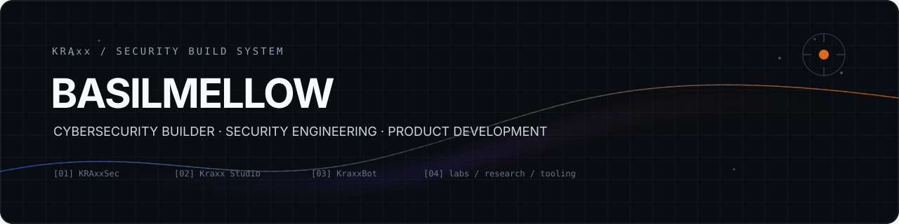

<p align="center">
  
</p>

<p align="center">
  <a href="https://kraxxsec.com">KraxxSec</a>
  ·
  <a href="https://kraxxstudio.com">Kraxx Studio</a>
  ·
  <a href="https://kraxxbot.kraxxsec.com/login">KraxxBot</a>
  ·
  <a href="https://kraxxdeceit.kraxxsec.com">KraxxDeceit</a>
  ·
  <a href="https://www.linkedin.com/in/mohamed-basil-966a8225a/">LinkedIn</a>
</p>

```text
$ whoami
basilmellow :: cybersecurity builder


$ ./current_build
KRAxx
├── KraxxSec       security & research
├── Kraxx Studio   digital products & engineering
├── KraxxDeceit    sandboxed browser security research
├── Kraxx PayGuard AI payment authorization firewall
├── KraxxBot       Discord operations & automation
├── Kraxx HxL      secure voting & discussion platform
├── KraxxLedger    offline Android business management
└── Roblox Worlds  OceanLine · Kindan · Couple · Crazy Alpaca

$ ./focus
security engineering • offensive security • detection • automation • product building
```

## ABOUT

I'm **Mohamed Basil** — a cybersecurity-focused builder working across security engineering, practical labs, automation, and product development.

My main project is **KRAxx**: a growing ecosystem of products and experiments built around technology, security, and useful software.


I like taking ideas from **"this should exist" → architecture → code → deployment → public product**. My work ranges from sandboxed security research and deterministic AI security systems to full-stack applications, business automation, and interactive game worlds. I focus on verifiable engineering, practical security boundaries, and building software that solves real problems.


## KRAxx / PRODUCT ECOSYSTEM

| Project | What it is |
|---|---|

| **Kraxx PayGuard** | Buyer-authorized AI payment firewall , audit trails and PayPal Sandbox integration |
| **Kraxx HxL** | Secure two-sided voting, discussions, moderation and realtime interaction platform (prelaunch) |
| **KraxxLedger** | Offline Android footwear inventory, sales, dealer orders and business management application |
| **OceanLine** | Roblox maritime cargo company management simulator with ports, fleet operations, contracts and progression (in development) |
| **Kindan** | Story-driven psychological horror experience set in a mysterious rural village (in development) |
| **Couple** | Roblox couples adventure with chapters, activities, progression, social interactions and home customization |
| **Crazy Alpaca** | Roblox social island and multiplayer minigame prototype (in development) |


## SECURITY WORK

```text

| **Kraxx PayGuard** | Immutable buyer authorization, AI-agent permission boundaries, deterministic payment firewall, injection-defense evaluation and auditable PayPal Sandbox workflows |
| **Kraxx HxL** | Full-stack security engineering with Supabase RLS, authorization enforcement, duplicate-vote prevention, concurrency testing and moderation controls |
| **KraxxLedger** | Offline-first Android application with SQLite persistence, inventory transactions, dealer orders, reports and backup/restore |
| **OceanLine** | Roblox maritime economy simulation with fleet management, cargo dispatch, voyage settlement and multiplayer testing |
| **Kindan** | Narrative-driven Roblox psychological horror project with original environmental storytelling and an expanding village world |
| **Couple** | Roblox social adventure featuring chapter progression, shared activities, personal housing and customization |
| **Crazy Alpaca** | Roblox social island and minigame prototype with custom environment and lobby systems |

```

### SELECTED BUILDS

| Build | Focus |
|---|---|
| **MindSec Compliance Simulation Lab** | Virtual environment mapping ISO 27001, PCI DSS, NIST CSF and CIS Controls with documentation, risk assessment and policy templates |
| **MindSec Splunk Lab** | Hands-on SIEM / detection engineering work using Splunk |
| **KraxxBot** | Production-oriented Discord bot + dashboard with multi-server architecture |
| **KraxxDeceit** | Isolated Playwright experiments, browser and system evidence, comparison studies, PDF reports and private case storage |
| **SAMS / LSEMS Portal** | Operational web portal and internal tooling for a roleplay emergency-services organization |

## STACK

<p align="center">
  
</p>

<p align="center">
  <code>Splunk</code>
  <code>Burp Suite</code>
  <code>OWASP</code>
  <code>SIEM</code>
  <code>EDR</code>
  <code>VMware</code>
  <code>Cloud Security</code>
  <code>Application Security</code>
  <code>Playwright</code>
  <code>Supabase</code>
  <code>Redis</code>
  <code>Security Automation</code>
  <code>AI Agent Security</code>
  <code>SQLite</code>

</p>

## CREDENTIALS / LEARNING


**Associate of ISC2** · **CPTS** · **ISC2 CC** · **Google Cybersecurity Certificate** · cybersecurity labs · CTFs · security research


I keep learning by building: labs, detections, tooling, web applications, automation, and complete systems rather than isolated tutorials.

## WRITING / COMMUNITY

**Medium** — security notes, technical write-ups and experiments  
**Hack The Box** — offensive-security practice  
**LinkedIn** — professional work and build updates  
**Discord** — communities, projects and collaboration

## NOW BUILDING

```text
[KRAxx]

01  hardening the security product ecosystem
02  advancing sandboxed browser security research
03  developing deterministic AI security systems
04  engineering reliable full-stack applications
05  building offline-first tools for real businesses
06  creating original interactive game worlds
07  documenting practical research and lessons
08  building in public — carefully, not noisily
```

## FIND ME

<p align="center">
  <a href="https://kraxxsec.com">Website</a> •
  <a href="https://kraxxstudio.com">Kraxx Studio</a> •
  <a href="https://www.linkedin.com/in/mohamed-basil-966a8225a/">LinkedIn</a> •
  <a href="https://kraxxdeceit.kraxxsec.com">KraxxDeceit</a> •
  <a href="https://github.com/Basilmellow">GitHub</a> •
  <a href="https://github.com/Basilmellow/KraxxPayGuard">Kraxx PayGuard</a> •
  <a href="https://devpost.com/software/kraxx-payguard">Kraxx PayGuard</a> 


</p>

<p align="center">
  <sub>Building KRAxx · security by craft · products over noise</sub>
</p>
